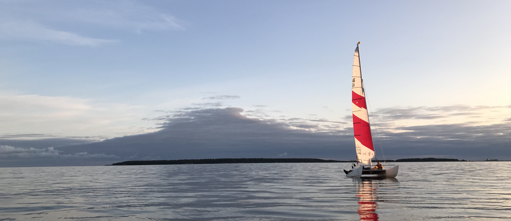

    "Der rote Faden" is a German idiom for the common thread that runs through a story (or a CV).

<figure>
    
    <figcaption style="background-color: #f2f2f2; padding: 5px;">In 2017, I sailed around the Baltic Sea in eleven weeks on a Topcat Spitfire catamaran from 1989. We didn't always read the surface winds right, as you can see. That's me on the port side, taking a break from paddling so we'd reach land before sunset. Credit: Jasper Peschel</figcaption>
</figure>

<section>
  

    I took the scenic route to climate science. I've always wanted to understand what holds the world together at its core, so I studied physics. Physics hands you a toolbox full of math and sends you out to put numbers on the world. I loved that from day one.
  

  

    In Berlin, my bachelor's thesis was about complex networks with nonlinear dynamics. They're everywhere, but you rarely see them. The best example sits right between your ears. For my master's thesis in Paris, I joined a neuroscience group and studied how signals spread and synchronize in neural networks. When that synchronization gets extreme, it can show up as epilepsy.
  

  

    After that, I wanted to stay in science and study something I could see from my window. I'm also a trained master shoemaker, so I've always had a soft spot for well-built, intricate things. The climate turned out to be one giant network, full of feedbacks and nonlinear dynamics, so my path circled back to where it started. Now I bring observations and models together to understand the atmosphere, and I plan to stay a while.
  

  

    <strong>P.S.</strong> Want to hear me talk? Check out the <a href="https://vimeo.com/806272814" target="_blank">promotion video</a> for the IMPRS at the MPI in Hamburg. For the shoot, I cycled through Hamburg's empty Speicherstadt at sunrise. It was freezing and a little surreal, and I loved it.
  

</section>