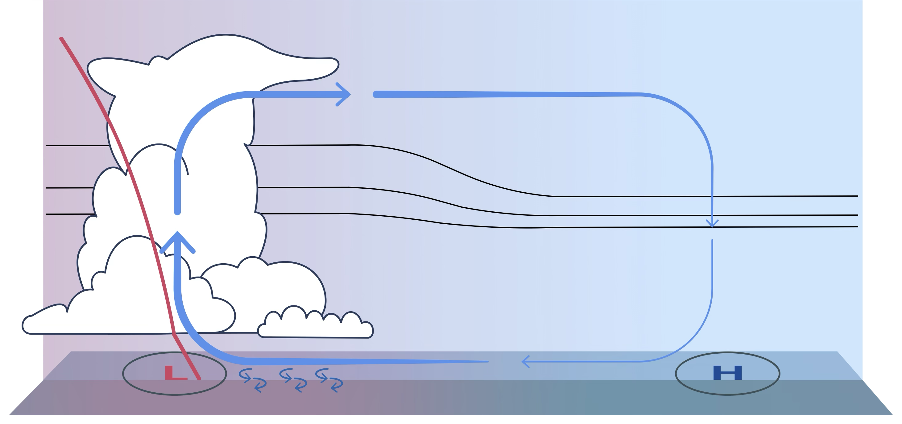
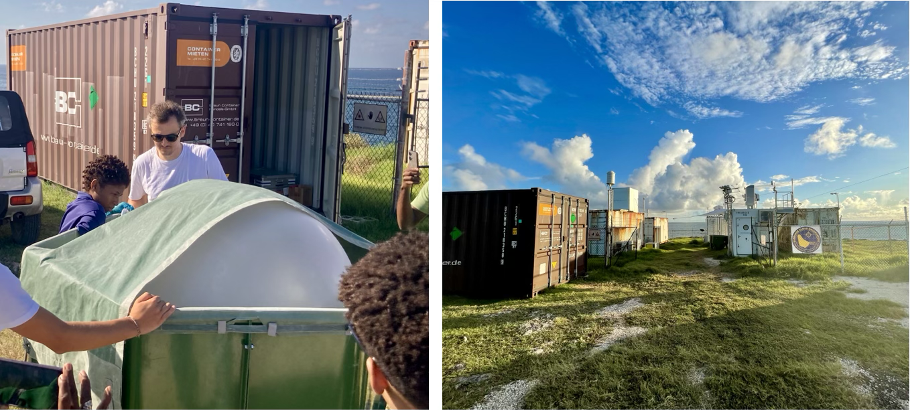

  
    Keywords: Boundary Layer, Surface Winds, Momentum Analysis, Air–Sea Interaction, High Resolution Climate Models, ORCESTRA
  

<h2>Winds at the equator</h2>

<figure>
    
    <figcaption style="background-color: #f2f2f2; padding: 5px;">Wind patterns along the equator from a two-year ICON simulation. Top: the region of interest. Bottom: daily mean winds averaged between 2°S and 2°N (land included). Green marks meridional winds, pink marks zonal winds, and white marks the transition between them.</figcaption>
</figure>
<section>
  

    For my PhD, I studied surface winds over the equatorial oceans. Two wind patterns dominate there. In the zonal pattern (pink), the winds blow along the equator. In the meridional pattern (green), they cross it, in some places at nearly right angles.
  

  

    Away from the equator, the trade winds follow an Ekman balance between the Coriolis force, the pressure gradient force and surface friction. Near the equator, the Coriolis force vanishes, and pressure gradients, friction and the horizontal and vertical transport of momentum take over. The kilometer-scale climate model ICON resolves these small contributions, so we can measure how much each one matters.
  

  

    
    

      Together with Divya Sri Praturi and Bjorn Stevens, I wrote a review of this work for <em>Physik Journal</em>, the member magazine of the German Physical Society (DPG). It appeared in the November 2026 issue, and one of our ICON simulations made the cover.
    

  

</section>

<h2>Too little heat, too little wind</h2>

<figure>
    
    <figcaption style="background-color: #f2f2f2; padding: 5px;">How surface heat fluxes shape surface pressure, an illustration. Heat from the ocean (small curly arrows, lower left) triggers convection, warms the air column (red profile) and lowers surface pressure (L). The free troposphere quickly evens out horizontal temperature differences. This adjusts the temperature profile over non-convective regions (blue) and keeps surface pressure high over cooler areas (H). The circulation (blue arrows) and the surface winds get stronger. Visualization: Yvonne Schrader.</figcaption>
</figure>
<section>
  

    The first study showed that the pressure gradient force matters most, and that the sea surface temperature (SST) largely sets it. Following <a href="https://journals.ametsoc.org/view/journals/atsc/44/17/1520-0469_1987_044_2418_otross_2_0_co_2.xml" target="_blank">Lindzen &amp; Nigam (1987)</a>, the SST alone gives a good estimate of the surface winds. So I was surprised when an atmosphere-only ICON simulation with a prescribed SST produced equatorial winds only about half as strong as ERA5.
  

  

    A comparison with the standalone COARE algorithm, which is built on observations from the <a href="https://journals.ametsoc.org/view/journals/bams/73/9/1520-0477_1992_073_1377_tctcor_2_0_co_2.xml" target="_blank">TOGA-COARE</a> campaign, showed why. ICON handles the momentum exchange reasonably well but lets far too little heat pass from the ocean to the air. In a sensitivity study, small increases in surface heat flux led to more deep convection. That drives an overturning circulation, which in turn speeds up the surface winds.
  

</section>

<h2>Fieldwork: ORCESTRA 2024</h2>

<figure>
    
    <figcaption style="background-color: #f2f2f2; padding: 5px;">Launching radiosondes during ORCESTRA 2024 at a BCO outreach event with local students (left, credit: Nina Robbins Blanch), and the <a href="https://barbados.mpimet.mpg.de/" target="_blank">Barbados Cloud Observatory</a> at Deebles Point (right).</figcaption>
</figure>

<section>
  

    In 2024, I joined the <a href="https://orcestra-campaign.org/intro.html" target="_blank">ORCESTRA</a> field campaign and led the radiosonde mission in Barbados. Over four weeks, a team of 15 young scientists and I launched 141 sondes. It was my first time in the tropics. Water vapor rose like bubbles in a glass of sparkling water, clouds poked above the transition layer like raised index fingers, and a moment later they rained out and were gone.
  

  

    Back in Germany, I combined all radiosonde launches from BCO (Barbados), INMG (Sal, Cape Verde) and the R/V Meteor into one dataset. The data and how we processed it are described in <a href="https://doi.org/10.5194/essd-18-1833-2026" target="_blank">Winkler et al. (2026)</a>. To access the data, install the <a href="https://docs.ipfs.tech/install/ipfs-desktop/#windows" target="_blank">IPFS client</a> and run:
  

  

    import xarray as xr  
    ds = xr.open_dataset("ipfs://bafybeid7cnw62zmzfgxcvc6q6fa267a7ivk2wcchbmkoyk4kdi5z2yj2w4", engine="zarr")
  

</section>