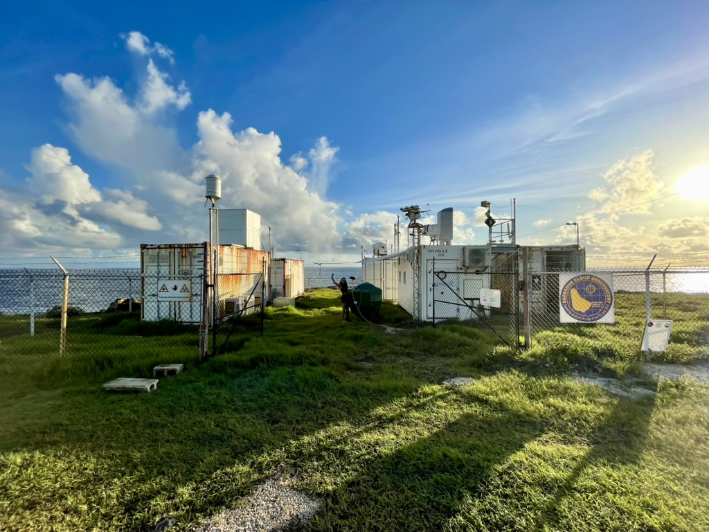

<a href="/assets/CV/WINKLER_Marius_CV.pdf" target="_blank" download class="button">📄 Download CV</a>

I am a postdoctoral researcher, working at the intersection of atmosphere–ocean interaction and boundary layer dynamics. I completed my Ph.D. in Earth System Sciences at the Max-Planck-Institut and Universität Hamburg (2021–2025), where I focused on boundary layer wind balances and their influence on equatorial sea-surface temperatures. My work was advised by Bjorn Stevens and Juan Pedro Mellado and centered on momentum analysis, surface winds, and tropical climate dynamics.

Before my Ph.D., I studied theoretical physics at the École Normale Supérieure in Paris and the Technische Universität Berlin. My Master's thesis explored phase response approaches to neural activity models with delay, combining nonlinear dynamics and neuroscience. I hold a Bachelor's degree in Physics from TU Berlin, where I investigated synchronization in networks of coupled oscillators. Alongside this academic path, I am a bespoke shoemaker
,
having trained first as a journeyman and qualified as a Master Craftsman in 2026, an experience that sharpened my eye for detail, deepened my patience with hard problems, and taught me the humility of standing before something not yet understood.

In September 2024, I took part in the ORCESTRA field campaign at the Barbados Cloud Observatory as a field scientist, where I coordinated atmospheric observations and led the radiosonde launch team on Barbadis. Since 2021, I have also contributed to science communication as a member of the institute’s social media team, helping to share climate research with broader audiences.

<figure>
    
    <figcaption style="background-color: #f2f2f2; padding: 5px;">Preparing a radiosonde for launch just after sunrise at the Barbados Cloud Observatory during the ORCESTRA field campaign 2024 with a stunning view across the Atlantic. </figcaption>
</figure>

---
layout: single
title: "CV"
permalink: /cv/
---

<a href="/assets/CV/WINKLER_Marius_CV.pdf" target="_blank" download class="button">📄 Download CV</a>

I'm a postdoctoral researcher working on air-sea interaction and boundary-layer dynamics in the tropics.

From 2021 to 2025, I did my Ph.D. in Earth System Sciences at the Max Planck Institute for Meteorology and Universität Hamburg, advised by Bjorn Stevens and Juan Pedro Mellado. I studied the wind balance of the boundary layer over the equatorial oceans and how it links to sea surface temperature.

Before that, I studied theoretical physics at the École Normale Supérieure in Paris and at TU Berlin. My master's thesis applied phase response methods to neural activity models with delay. For my bachelor's at TU Berlin, I worked on synchronization in networks of coupled oscillators.

In 2024, I joined the ORCESTRA field campaign at the Barbados Cloud Observatory, where I coordinated the atmospheric observations and led the radiosonde team. Since 2021, I've also been part of the institute's social media team, sharing climate research with a wider audience. In 2026, I led a review article for <a href="https://pro-physik.de/zeitschriften/physik-journal/2026-11/" target="_blank"><em>Physik Journal</em></a>, and our simulation made the cover.

I'm also a bespoke shoemaker
.
I trained as a journeyman and became a master shoemaker in 2026. The craft gave me an eye for detail and a lot of patience with hard problems.

<figure>
    
    <figcaption style="background-color: #f2f2f2; padding: 5px;">Preparing a radiosonde for launch just after sunrise at the Barbados Cloud Observatory during ORCESTRA 2024, with a view across the Atlantic.</figcaption>
</figure>